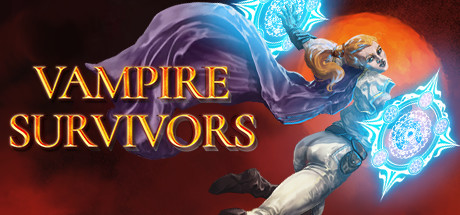

**Vampire Survivors by poncle (2022) is the game that launched the survivor genre.**

---

## 📖 About

Vampire Survivors by poncle (2022) is the game that launched the survivor genre. You move through arenas, auto-attacking escalating hordes, building overpowered weapon evolutions. It appears simple but unlocking all characters, achievements, and the true ending requires deep meta-knowledge.

## ⚠️ Problems Without Trainer

| Problem | Status |
|---------|--------|
| Weapon evolution requires specific passive item pairing with no in-game guide | ✅ Solved |
| Arcana unlocks demand specific achievement conditions that are easy to miss | ✅ Solved |
| Gold farming for character unlocks becomes a grind after 20 hours | ✅ Solved |
| Hyper mode enemies outscale weak builds before evolution threshold | ✅ Solved |
| Secret character unlocks require obscure non-obvious in-game actions | ✅ Solved |

## ✅ Solution

The **Vampire Survivors Trainer** solves all these issues, giving you complete control so you can focus on enjoying the game.

## 🎯 Features

- Unlimited Resources / Currency
- God Mode / Invincibility
- Instant Skill & Ability Cooldown
- One-Hit Kill
- Freeze Timers
- Unlock All Items & Achievements
- Custom Speed Multiplier
- Infinite Stamina / Energy

## 🚀 Quick Start

1. **Disable Windows Defender** temporarily (trainer may trigger false positive)
2. Get the trainer from the button above
3. Launch Vampire Survivors
4. Run the trainer as Administrator
5. Use the hotkeys to activate cheats in-game

## 💎 Free vs Pro

| Feature | Free | Pro |
|---------|------|-----|
| God Mode | ✅ | ✅ |
| Unlimited Resources | ✅ | ✅ |
| Advanced Cheats | ❌ | ✅ |
| Auto-Updates | ❌ | ✅ |
| Priority Support | ❌ | ✅ |

## 💻 Requirements

- Windows 10 / 11 (64-bit)
- Vampire Survivors (any version)
- .NET Framework 4.8+
- DirectX 11+

## 🍎 macOS

## ⚖️ Legal

Educational and single-player use only.

---

